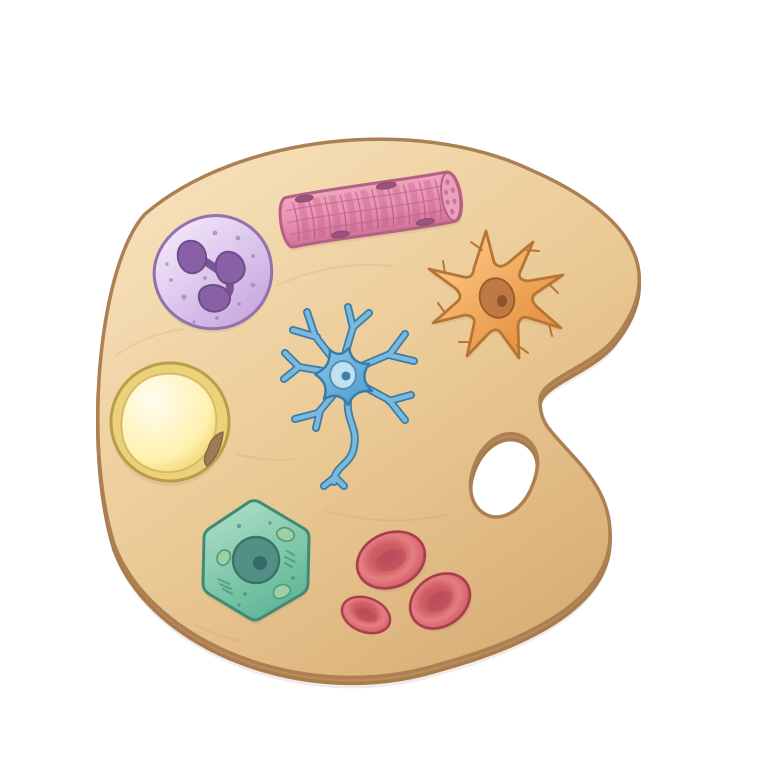
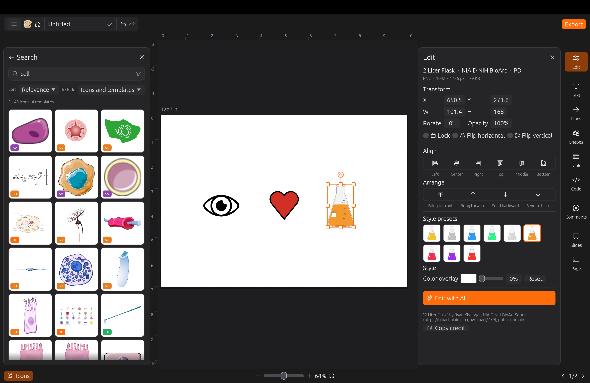

<p align="center">
  
</p>

# BioCartoon app

BioCartoon is a free and open-source tool for creating biology figures with illustrations. We compile existing open biology-focused illustration resources and introduce our own illustrations in a single database with a graphical interface for search and figure generation.

This repository holds the source code for the desktop app, web app, and website. The icon database and the `biocartoon` command-line interface are in [biocartoon](https://github.com/josephrich98/biocartoon).

## Usage

Web application: [app.biocartoon.com](https://app.biocartoon.com)

Install Desktop application: [app.biocartoon.com/download](https://app.biocartoon.com/download)



## Resources

<!-- app-stats:start (generated by biocartoon/data/readme_stats.py) -->
15,344 icons and 6 templates across 8 resources.

| source | icons | license | examples |
|---|---|---|---|
| [BioCartoon](https://www.biocartoon.com) | 10 | CC0 |  |
| [Bioicons](https://bioicons.com) | 2,793 | CC BY / CC0 / CC BY-SA / MIT / BSD |      |
| [Health Icons](https://healthicons.org) | 749 | CC0 |      |
| [NIAID NIH BioArt Source](https://bioart.niaid.nih.gov) | 936 | Public Domain |      |
| [OpenMoji](https://openmoji.org) | 4,495 | CC BY-SA 4.0 |      |
| [Reactome icon library](https://reactome.org/icon-lib) | 2,569 | CC BY 4.0 |      |
| [SciDraw](https://scidraw.io) | 772 | CC BY 4.0 / CC0 |      |
| [Servier Medical Art](https://smart.servier.com) | 3,020 | CC BY 4.0 |      |

<details><summary>Example icon credits</summary>

- "DNA colored" by DBCLS, Bioicons (https://togotv.dbcls.jp/en/pics.html), CC-BY-4.0 (https://creativecommons.org/licenses/by/4.0/)
- "Lymphocyte" by DBCLS, Bioicons (https://togotv.dbcls.jp/en/pics.html), CC-BY-4.0 (https://creativecommons.org/licenses/by/4.0/)
- "heart" by Servier, Bioicons (https://smart.servier.com/), CC-BY-3.0 (https://creativecommons.org/licenses/by/3.0/)
- "Mouse" by DBCLS, Bioicons (https://togotv.dbcls.jp/en/pics.html), CC-BY-4.0 (https://creativecommons.org/licenses/by/4.0/)
- "Human male" by DBCLS, Bioicons (https://togotv.dbcls.jp/en/pics.html), CC-BY-4.0 (https://creativecommons.org/licenses/by/4.0/)
- "DNA" by Resolve to Save Lives, Health Icons (https://healthicons.org/icon/filled/body/dna), CC0
- "Cell Nuclei" by Resolve to Save Lives, Health Icons (https://healthicons.org/icon/filled/body/cell-nuclei), CC0
- "Heart" by Resolve to Save Lives, Health Icons (https://healthicons.org/icon/filled/body/heart-organ), CC0
- "Rat" by Resolve to Save Lives, Health Icons (https://healthicons.org/icon/filled/zoonoses/animal-rat), CC0
- "Person" by Resolve to Save Lives, Health Icons (https://healthicons.org/icon/filled/people/person), CC0
- "DNA" by Ryan Kissinger, NIAID NIH BioArt Source (https://bioart.niaid.nih.gov/bioart/123), public domain
- "T Cell" by Ryan Kissinger, NIAID NIH BioArt Source (https://bioart.niaid.nih.gov/bioart/508), public domain
- "Human Heart" by Ryan Kissinger, NIAID NIH BioArt Source (https://bioart.niaid.nih.gov/bioart/228), public domain
- "Lab Mouse" by Ryan Kissinger, NIAID NIH BioArt Source (https://bioart.niaid.nih.gov/bioart/279), public domain
- "Human Male Outline Type VI" by Ryan Kissinger, NIAID NIH BioArt Source (https://bioart.niaid.nih.gov/bioart/238), public domain
- "dna" by Alan Seng, OpenMoji (https://openmoji.org/library/emoji-1F9EC/), CC-BY-SA-4.0 (https://creativecommons.org/licenses/by-sa/4.0/)
- "kiwi fruit" by Marius Schnabel, OpenMoji (https://openmoji.org/library/emoji-1F95D/), CC-BY-SA-4.0 (https://creativecommons.org/licenses/by-sa/4.0/)
- "anatomical heart" by Tonia Reinhardt, OpenMoji (https://openmoji.org/library/emoji-1FAC0/), CC-BY-SA-4.0 (https://creativecommons.org/licenses/by-sa/4.0/)
- "mouse" by Sofie Ascherl, OpenMoji (https://openmoji.org/library/emoji-1F401/), CC-BY-SA-4.0 (https://creativecommons.org/licenses/by-sa/4.0/)
- "person" by Johanna Wellnitz, OpenMoji (https://openmoji.org/library/emoji-1F9D1/), CC-BY-SA-4.0 (https://creativecommons.org/licenses/by-sa/4.0/)
- "DNA 3D" by David Eccles, Reactome Icon Library (https://reactome.org/icon-lib/R-ICO-012630), CC-BY-4.0 (https://creativecommons.org/licenses/by/4.0/)
- "Cell generic 01" by Cristoffer Sevilla, Reactome Icon Library (https://reactome.org/icon-lib/R-ICO-012548), CC-BY-4.0 (https://creativecommons.org/licenses/by/4.0/)
- "Heart" by Cristoffer Sevilla, Reactome Icon Library (https://reactome.org/icon-lib/R-ICO-014671), CC-BY-4.0 (https://creativecommons.org/licenses/by/4.0/)
- "Mosquito" by Cristoffer Sevilla, Reactome Icon Library (https://reactome.org/icon-lib/R-ICO-014760), CC-BY-4.0 (https://creativecommons.org/licenses/by/4.0/)
- "Male body with organs" by Cristoffer Sevilla, Reactome Icon Library (https://reactome.org/icon-lib/R-ICO-013956), CC-BY-4.0 (https://creativecommons.org/licenses/by/4.0/)
- "DNA" by John Chilton, SciDraw (https://scidraw.io/drawing/dna-8709d1cf), CC-BY-4.0 (https://creativecommons.org/licenses/by/4.0/)
- "cell" by Hu, SciDraw (https://scidraw.io/drawing/cell-7d505ae8), CC-BY-4.0 (https://creativecommons.org/licenses/by/4.0/)
- "Heart" by John Chilton, SciDraw (https://scidraw.io/drawing/heart-d090dc66), CC-BY-4.0 (https://creativecommons.org/licenses/by/4.0/)
- "Mouse" by Tom Baden, SciDraw (https://scidraw.io/drawing/mouse-2902704e), CC-BY-4.0 (https://creativecommons.org/licenses/by/4.0/)
- "Human silhouette" by Zane Mitrevica, SciDraw (https://scidraw.io/drawing/human-silhouette-a5894ef6), CC-BY-4.0 (https://creativecommons.org/licenses/by/4.0/)
- "dna", Servier Medical Art (https://smart.servier.com/smart_image/dna/), CC-BY-4.0 (https://creativecommons.org/licenses/by/4.0/)
- "Empty cell", Servier Medical Art (https://smart.servier.com/smart_image/cell-red-blue/), CC-BY-4.0 (https://creativecommons.org/licenses/by/4.0/)
- "Heart", Servier Medical Art (https://smart.servier.com/smart_image/heart-organ/), CC-BY-4.0 (https://creativecommons.org/licenses/by/4.0/)
- "Mouse", Servier Medical Art (https://smart.servier.com/smart_image/mouse/), CC-BY-4.0 (https://creativecommons.org/licenses/by/4.0/)
- "African man", Servier Medical Art (https://smart.servier.com/smart_image/african-adult-man/), CC-BY-4.0 (https://creativecommons.org/licenses/by/4.0/)

</details>
<!-- app-stats:end -->

## Building from source

The editor is built with a crate from the [biocartoon](https://github.com/josephrich98/biocartoon)
repository (`app/Cargo.toml`: `path = "../../biocartoon/catalog"`), so clone both repositories
into the same parent directory:

```
git clone https://github.com/josephrich98/biocartoon.git
git clone https://github.com/josephrich98/biocartoon-app.git
cd biocartoon-app/app
```

You need a stable [Rust toolchain](https://rustup.rs). Then:

| what | command (from `app/`) |
|---|---|
| Run the desktop app | `cargo run --release` |
| Run the tests | `cargo test --release` |
| Build the web app into `dist/` | `trunk build --release` |
| Build desktop installers into `target/packages/` | `cargo packager --release` |

Linux needs `libxkbcommon-dev libgl1-mesa-dev libwayland-dev libx11-dev` for the desktop build.

Windows needs the Visual Studio Build Tools with the C++ workload, which provide the linker
(without them the build fails with "linker `link.exe` not found"):

```
winget install Microsoft.VisualStudio.2022.BuildTools --override "--passive --wait --add Microsoft.VisualStudio.Workload.VCTools --includeRecommended"
```

Then build from PowerShell or cmd, not Git Bash: Git Bash's own `link` command shadows the MSVC
linker and the build fails with `link: extra operand`.

The web build needs `rustup target add wasm32-unknown-unknown` and
[trunk](https://trunkrs.dev) (`cargo install trunk --locked`). It compiles SQLite from C to
wasm32, which needs a clang that can target wasm32. `app/.cargo/config.toml` points at Homebrew's
LLVM (`brew install llvm`) on macOS. On other systems, override it with your own clang:

```
export CC_wasm32_unknown_unknown=clang
export AR_wasm32_unknown_unknown=llvm-ar
```

`cargo packager` comes from `cargo install cargo-packager --locked`. Releases are built by
[.github/workflows/release.yml](.github/workflows/release.yml) for every `v*` tag.

## License

Copyright (c) 2026 Joseph Rich. This repository is open source under the [GNU Affero General Public License v3.0 or later](LICENSE). Third-party illustrations and icons keep their own licenses; see [NOTICE.md](NOTICE.md).

## Contributing

Contributions are welcome; see [CONTRIBUTING.md](CONTRIBUTING.md). Pull requests need a signed
[Contributor License Agreement](CLA.md). Contributors keep the copyright in their work, and
artists are credited under the name they choose.

## FAQs

**Q: Is it really free?**

A: Yes, it is! No accounts, subscriptions, publication licenses, microtransactions, watermarks — 100% free.

**Q: Can I use figures in my papers/presentations?**

A: Yes. The figures you make are yours. The illustrations in them keep their own licenses, so credit the creator wherever a license asks for it (CC BY and CC BY-SA). The editor shows the license and credit line for every illustration.

**Q: Do I need an account?**

A: No. Open the web app and start creating. An account is an option if you want your data to be saved long-term.

**Q: Do my projects save after I exit the app?**

A: Yes. The desktop app always saves your projects on your computer. In the web app, signing in keeps an online copy of your projects in your account. Without signing in, the web app saves projects in your browser's storage, which the browser may clear (Safari does after 7 days without a visit; other browsers may when the device runs low on space or when you clear site data). Either way, you can save any project as a .biocartoon file, or download every project at once as a backup .zip, and open them again later. Changes are saved automatically within a couple of seconds, and the web app warns you if you close the tab before the last change is saved.

**Q: What user information do you store?**

A: By default, we don't store any user data. You can use the web app or desktop app without an account, and your figures, uploaded icons, and favorites (and any words you add to the spelling dictionary) stay on your own device (starring an icon only adds to its public count under a random ID, not anything tied to you). If you would like long-term storage of your figures in the web app, you can sign in with Google or GitHub, and then only your name, email, and an online copy of your figures are stored in a secure database. No passwords are ever stored. Deleting a figure or your account will remove this information from the online database as well.

**Q: How do I contribute an illustration or template?**

A: In the app, upload an icon or save a slide as a template and tick "Submit to the shared library". Submissions are reviewed before they appear for everyone. You keep the copyright and choose CC0 or CC BY 4.0.

**Q: Why is there both a desktop app and web app?**

A: The web app allows one to create figures immediately without any software downloads. The desktop app enables database indexing for quick searches, as well as downloads for offline use.

**Q: Can I bulk download the database?**

A: Yes. Open the app, click on the top-left menu, and click "Download".

## Other Links

Website: [www.biocartoon.com](https://www.biocartoon.com)

Database and CLI source code: [github.com/josephrich98/biocartoon](https://github.com/josephrich98/biocartoon)

Application and website source code: [github.com/josephrich98/biocartoon-app](https://github.com/josephrich98/biocartoon-app)

Icon SQLite database: [assets.biocartoon.com/catalog/assets.sqlite.gz](https://assets.biocartoon.com/catalog/assets.sqlite.gz)

Template SQLite database: [assets.biocartoon.com/catalog/templates.sqlite.gz](https://assets.biocartoon.com/catalog/templates.sqlite.gz)

## Support

If biocartoon is useful to you, you can [buy me a coffee](https://buymeacoffee.com/josephrich) ☕
